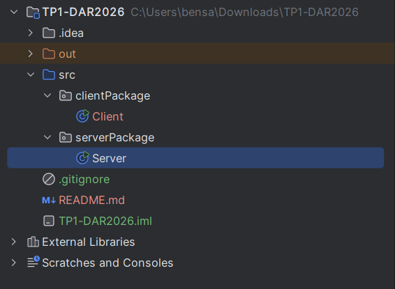
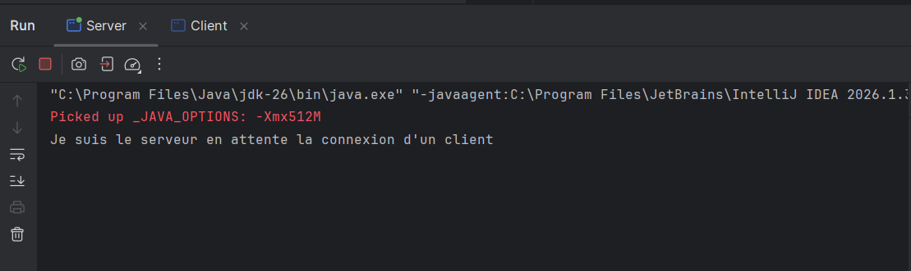
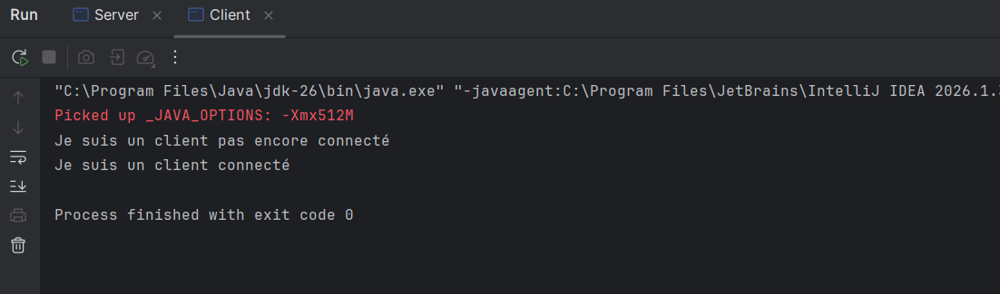
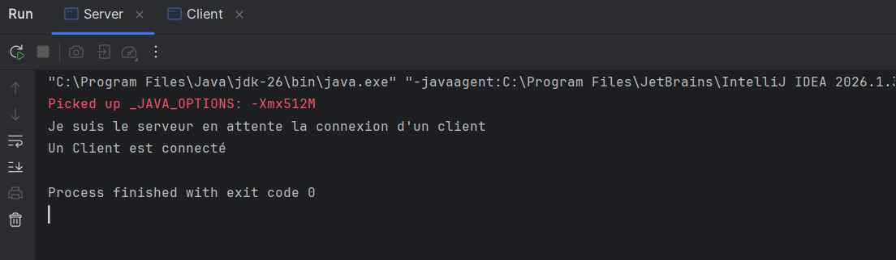
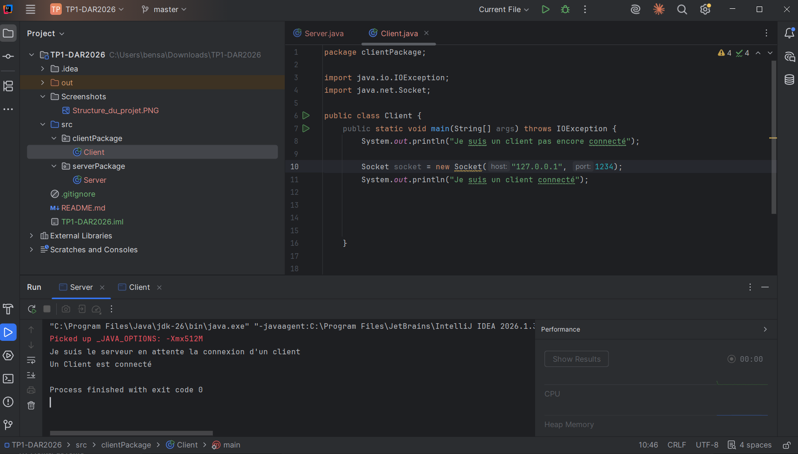
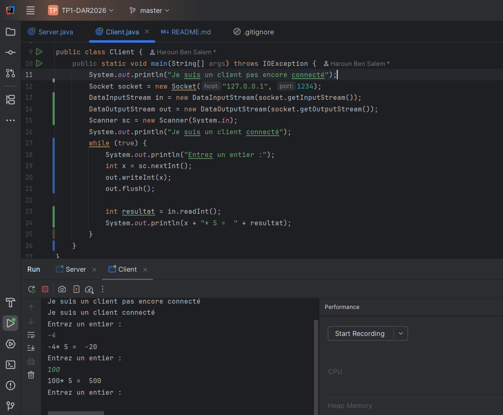
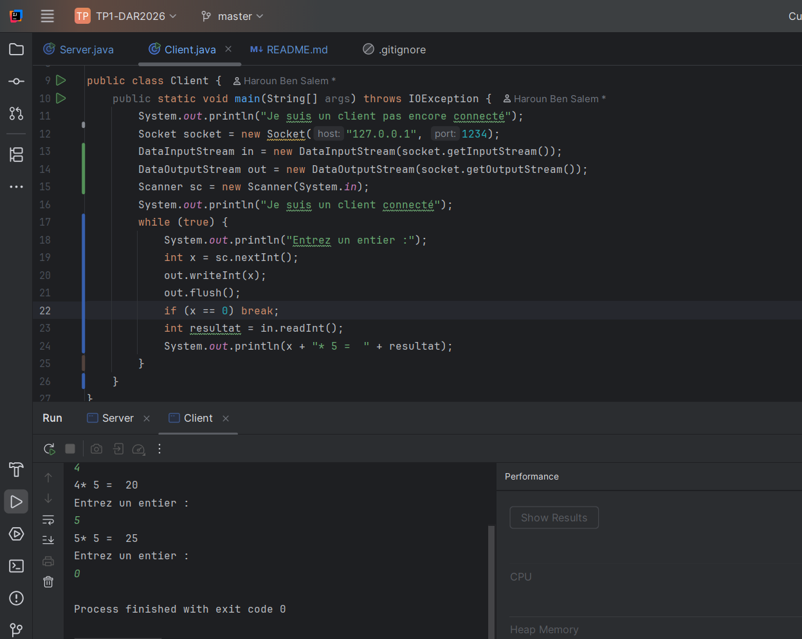

# TP1-DAR2026 — Les sockets TCP en Java

## 1) Objectif
Le but de ce TP est de réaliser une connexion entre un client et un serveur en Java en utilisant les sockets TCP.
## 2) Structure du projet
J'ai créé un projet Java nommé **TP1-DAR2026** avec deux packages : serverPackage et clientPackage.

## 3) Création du serveur
Le serveur utilise ServerSocket sur le port 1234. Il attend la connexion d'un client avec la méthode accept().

Au début, le serveur affiche un message pour indiquer qu'il attend une connexion. Quand le client se connecte, le serveur affiche un deuxième message.

## 4)Création du client
Le client utilise la classe Socket pour se connecter au serveur sur le port 1234 avec l'adresse localhost.

Après la connexion, un message s'affiche dans la console pour confirmer que le client est connecté.

## 5)Test de connexion
J'ai lancé le serveur en premier, puis le client. La connexion s'est bien établie et le serveur a affiché le message indiquant qu'un client était connecté.

## 6)Utilisation d'une adresse IP
J'ai remplacé localhost par 127.0.0.1 dans le code du client, en gardant le même port (1234). J'ai relancé les deux applications et la connexion a fonctionné.

## 7)Conclusion
Ce TP m'a permis de comprendre comment établir une connexion TCP entre un client et un serveur en Java. J'ai utilisé ServerSocket pour attendre la connexion et Socket pour connecter le client au serveur. 

# Service de Calculatrice

## Création du service de multiplication

### 1) Version de base (flux simples)
Dans un premier temps, les échanges utilisent les flux classiques InputStream / OutputStream.

| | Action | Méthode |
|---|---|---|
| a | Le client saisit un entier `x` au clavier | `Scanner.nextInt()` |
| b | Le client envoie `x` au serveur | `out.write(x)` |
| c | Le serveur reçoit `x` | `in.read()` |
| d | Le serveur calcule `x * 5` | `int resultat = x * 5` |
| e | Le serveur envoie le résultat | `out.write(resultat)` |
| f | Le client reçoit et affiche le résultat | `in.read()` |

### 2) Lancement : Serveur puis Client
**Lancement du serveur :**

Le serveur est lancé en premier. Il crée un `ServerSocket` et attend une connexion avec `accept()`.

**Lancement du client :**

Le client est lancé ensuite. Il se connecte au serveur et les deux côtés affichent un message de connexion.
### 3) Tests : positif, négatif, zéro

**Interprétation :**

| x saisi | Résultat attendu | Résultat obtenu | Correct ? |
|---------|------------------|-----------------|-----------|
| 7       | 35               | 35              | Oui |
| 0       | 0                | 0               | Oui |
| -4      | -20              | 236             | Non |
| 100     | 500              | 244             | Non |

`OutputStream.write(int)` n'envoie que **l'octet de poids faible** (8 bits). Pour `-4`, l'octet envoyé est `0xFC`, que le serveur lit comme `252`. Le calcul `252 * 5 = 1260` est ensuite tronqué à un octet (`1260 & 255 = 236`). Le même problème apparaît pour toute valeur supérieure à 255 (ex. `500` devient `244`). Les flux simples ne permettent donc pas de transmettre correctement les entiers négatifs ou grands.

### 4) Gestion des négatifs avec DataInputStream / DataOutputStream

Pour corriger le problème, on utilise `java.io.DataOutputStream` et `java.io.DataInputStream`, qui permettent d'envoyer et recevoir un `int` complet sur **4 octets** (complément à 2, big-endian).

**Nouveau test**

### 5)Saisies multiples et arrêt propre

Le client et le serveur sont modifiés pour fonctionner en boucle :

- le client saisit plusieurs entiers successivement ;
- après chaque saisie, il envoie l'entier, reçoit `x * 5` et l'affiche ;
- la boucle continue tant que l'entier saisi est différent de `0` ;
- lorsque `0` est saisi, la communication s'arrête et les sockets sont fermés des deux côtés.

